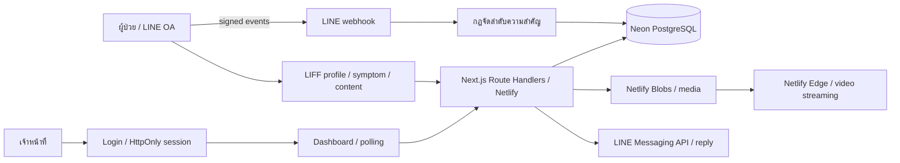

# Ileal Conduit Care

ระบบต้นแบบติดตามผู้ป่วยผ่าน LINE OA / LIFF พร้อมแดชบอร์ดสำหรับพยาบาล

[แดชบอร์ดเจ้าหน้าที่](https://ileal-conduit-dashboard.netlify.app/dashboard)

## Architecture



- Next.js 16 App Router / React 19 / TypeScript / Tailwind CSS / Recharts
- Netlify builds from GitHub `main`; Neon stores patients, messages, issues, assessments, video metadata and content events.
- Uploaded videos and posters use **Netlify Blobs** in the site-wide `patient-education-media` store. Files persist across deploys. Bundled clips under `public/videos` are served by Netlify's CDN.
- Uploads use authenticated 3 MB chunks, retries and finalization. Only complete files become public at `/media/:id`. The Edge Function supports byte ranges for seeking, HEAD and conditional requests, and streams without buffering an entire clip in a serverless response.
- `lib/server-db.ts` is a PostgreSQL adapter. The legacy `getD1()` name does not mean Cloudflare D1 is used.
- Dashboard APIs check the session cookie before returning patient data.

## User flows

1. ผู้ป่วยเปิด Rich Menu → กรอกประวัติใน LIFF → แจ้งปัญหาและระยะเวลาที่เริ่มพบ
2. เซิร์ฟเวอร์จัดระดับตามกฎใน `lib/triage.ts` → บันทึกเคส → แดชบอร์ดอัปเดตจาก polling
3. พยาบาลเข้าสู่ระบบ → ตรวจเคส → ตอบกลับผ่าน LINE → บันทึกสถานะและเวลาตอบ
4. ผู้ป่วยเปิดคลังวิดีโอ → เลือกดูคลิป → เก็บสถิติการเปิดหน้าและเล่นวิดีโอ

## Local development

ต้องใช้ Node.js >=22.13 และ pnpm

```sh
pnpm install --shamefully-hoist
pnpm dev
```

สำหรับระบบจริง ให้คัดลอก `.env.example` เป็น `.env.local` แล้วกำหนด `DATABASE_URL`, `DASHBOARD_PASSWORD`, `LINE_CHANNEL_ACCESS_TOKEN`, `LINE_CHANNEL_SECRET`, `LIFF_PROFILE_URL`, `LIFF_SYMPTOM_URL`, `PUBLIC_BASE_URL` ตามบริการของคุณ ใช้ `pnpm db:init` กับฐานข้อมูลที่เลือกไว้เท่านั้น ห้าม commit secrets

ใช้ `netlify dev` เมื่อต้องทดสอบอัปโหลดและเล่นไฟล์ Blobs ในเครื่อง โดยใช้ local sandbox ของ Netlify; `pnpm dev` ใช้สำหรับพัฒนาหน้าเว็บทั่วไป จัดการไฟล์บนเว็บจริงได้ที่ Netlify → Data & Storage → Blobs ไม่ต้องใช้ Vercel Blob token อีก

### Media migration

`scripts/migrate-media-to-netlify.mjs` ย้ายเฉพาะไฟล์เก่าที่คลิปในฐานข้อมูลอ้างอิง ใช้ฐานข้อมูลใน `.env.local`, site ที่เชื่อมใน `.netlify/state.json` และบัญชีที่ล็อกอิน Netlify CLI (หรือ `NETLIFY_AUTH_TOKEN`) เก็บข้อมูลสำรองของรายการคลิปและแผนย้ายไว้ใน `.netlify/migrations/media-migration.json` ซึ่งไม่ถูก commit

```sh
node scripts/migrate-media-to-netlify.mjs --plan https://ileal-conduit-dashboard.netlify.app
node scripts/migrate-media-to-netlify.mjs --copy https://ileal-conduit-dashboard.netlify.app
# Deploy the new media routes before switching database references.
node scripts/migrate-media-to-netlify.mjs --switch https://ileal-conduit-dashboard.netlify.app
node scripts/migrate-media-to-netlify.mjs --verify https://ileal-conduit-dashboard.netlify.app
```

การ copy ตรวจ SHA-256 ทุกส่วนที่อ่านกลับจาก Blobs และการ switch ตรวจไฟล์เต็มกับ byte ranges ผ่านโดเมนจริงก่อนเปลี่ยน URL ใช้ conditional update เพื่อไม่เขียนทับรายการที่เจ้าหน้าที่แก้ระหว่างย้าย เก็บชื่อ วันที่เผยแพร่ ยอดวิว และระยะเวลาคลิปไว้ ไฟล์ต้นฉบับไม่ถูกลบโดยสคริปต์นี้ หลังย้ายสำเร็จให้เอา token ของพื้นที่เก่าออกจาก environment และ redeploy

Production migration verified on 2026-10-15: both library entries use Netlify-hosted media, with zero remaining Vercel Blob references in the video library. The migrated video and poster passed full-file SHA-256 and byte-range checks. The legacy storage token has been removed from Netlify configuration; original source objects remain as a backup and are not used by the app.

Live transport smoke check (creates and removes only its own unlisted synthetic asset; requires the staff password in `.env.local`):

```sh
node scripts/verify-netlify-media.mjs https://ileal-conduit-dashboard.netlify.app
```

Webhook: `/api/line/webhook`; LIFF endpoints: `/liff/profile` และ `/liff/symptom` ใช้ URL HTTPS ของ deployment จากนั้นกด Verify ใน LINE Developers Console

## Automated checks

```sh
pnpm test
pnpm typecheck
pnpm build
```

GitHub Actions รัน checks ทุก push/PR โดยไม่ใช้ production secrets

- Triage: urgent keywords, category/onset boundaries, missing fields and intake completion.
- Webhook: HMAC verification, tampered payloads, missing secret, malformed JSON/events, LINE's empty verification event. DB is mocked; tests never contact LINE.
- Authentication: wrong credentials, missing/tampered cookie, unauthenticated dashboard, secure production cookie and fail-closed missing password.
- Media: authenticated uploads, type/size validation, complete parts before publication, identical retries, expired sessions, safe cancellation/deletion, byte-range seeking, HEAD, ETags and browser-upload retries. Storage and DB are mocked in these tests.

## ขอบเขตของต้นแบบ

กฎ triage เป็น keyword/rule-based และยังไม่ผ่าน clinical validation การทดสอบยืนยันพฤติกรรมโค้ด ไม่ยืนยันความถูกต้องทางการแพทย์ ยังมีข้อจำกัดเรื่องข้อความปฏิเสธ เช่น “ไม่มีไข้” และ webhook redelivery/idempotency ต้องพัฒนาต่อก่อนใช้งานจริงในวงกว้าง

Session ปัจจุบันเป็น deterministic token จากรหัสผ่าน ไม่มี server-side expiry/revocation แม้ cookie มี Max-Age; ควรเปลี่ยนเป็น session ที่หมดอายุจริงและเพิ่ม rate limiting ก่อนขยายผู้ใช้ การตอบกลับและการบันทึก DB ยังไม่เป็น distributed transaction ชุดทดสอบนี้ยังไม่แทน end-to-end บนโทรศัพท์ LINE และการทดสอบส่งข้อความจริง
